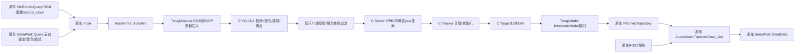

# 同济算法重新移植与数据流

## 调用链

保持原车主程序及设备初始化，未移植 C 的 main、相机、串口、ROS2 或全向相机实现。
原车全向感知入口保留原实现。大符算法来自 A，不使用此前融合修改。

配置：`text.yaml:Algorithm.backend` 支持 `tongji` / `legacy`。缺少该分组仍走 Legacy；当前候选默认 Tongji。
Legacy 是 A405b408 的算法；两个路径共同使用原车硬件与协议。

## 关键函数与 C++ 参数关系

| 函数 | 谁调用/输入来源 | 参数、状态和输出 | 直接物理设备 |
|---|---|---|---|
| `HikRobot::Query` | main；驱动采集队列 | Mat 与时间戳由引用返回；Mat 管理图像存储 | 工业相机/USB SDK |
| `SerialPort::Query` | main；串口线程队列 | `Data_Save&` 写入图像时间对应姿态；时间为 const 引用 | 下位机串口 |
| `AutoArmor::AutoAim` | main/review | `Mat&` 图像、`const Data_Save&` 只读姿态、`Data_Get&` 写出视觉字段；unique_ptr 拥有 Adapter/Planner | 无，输出交回 main |
| `TongjiAdapter::process` | AutoArmor | `const Mat&`、`const Data_Save&`；同步推理，RGB 转换产生自有 Mat；返回 shared_ptr 模型 | 无 |
| `TongjiAdapter::update` | process/离线测试 | 装甲板 list **值传递**，过滤只改副本；姿态 const 引用；修改自有 Tracker，输出独立运动模型快照 | 无 |
| `YOLO::detect` | Adapter | const Mat 引用；缩放/letterbox/同步 OpenVINO 请求；返回 list 值；模型实例保持推理状态 | CPU，未打开相机 |
| `Solver::solve` | Adapter/Tracker | `Armor&` 修改其中的世界位置/姿态；原车 K/D/R/t 通过 YAML::Node 注入 | 无 |
| `Tracker::track` | Adapter | `list<Armor>&` 会过滤/排序/解算；时间戳值传递；引用使用 Adapter 拥有的 Solver，不能提前销毁 | 无 |
| `Target::predict/update` | Tracker | 预测时间值、观测 const 引用；更新自有 EKF；11 维状态不写原车数据结构 | 无 |
| `TongjiModel::GetArmors` | 原车 Planner | 预测秒数值传递；按同济状态生成 Armors 值；包含 vz、长短半径、高度差 | 无 |
| `Planner::TrajectoryPlanning` | AutoArmor | shared_ptr 共享模型生命期；沿用原车 101 点轨迹/弹道/加速度处理 | 无 |
| `AutoArmor::Transmit` | AutoAim | 使用原车弧度到角度与 1e4 编码公式，修改 Data_Get；发送仍由 main 完成 | 无 |
| `SerialPort::SendData` | 原车 main | `const Data_Get&`，仍发送 A 原来的 21 字节 | 下位机串口 |

## 类型、坐标与状态接口

| 项目 | 约定/转换 |
|---|---|
| 相机图像 | A SDK 使用 Bayer→RGB；Adapter 转成 C 所需的 CV_8UC3 BGR，不改驱动 |
| 录像颜色 | A Recorder 直接写入 RGB 数组，未转换；原车 review 默认按 RGB 数组还原。其他普通录像（包括同济 demo）默认 BGR，必须按来源指定 |
| 角点 | C 为左上、右上、右下、左下；直接配 C 的 Solver 模型。Legacy A 为左上、左下、右下、右上，两套对象不交叉使用 |
| 颜色 | A 0=blue、1=red；C 枚举 0=red、1=blue，Adapter 通过语义配置映射，不能整数强转 |
| 类别 | C one..five→1..5，sentry→guard/7，outpost→6，base→8；仅用于内部身份，默认线上的 ID 保持 A 实际的 0（A 的 FoundID 更新被注释） |
| 尺寸 | SMALL=0.130×0.050 m；BIG=0.230×0.050 m；没有使用 C 的 135×56 mm |
| 相机坐标 | x右/y下/z前；原车 R 转为云台 x前/y左/z上；t 保留 [-.05,-.05,0] m |
| 云台到世界 | 与 A Slover 相同 `Rz(yaw) Ry(-pitch) Rx(roll)`；直接传矩阵，不虚构 C 的 IMU 安装标定 |
| 单位 | 内部位置 m、速度 m/s、角 rad、角速度 rad/s；补偿参数为 degree，输出为 degree×10000 |
| 时间 | 保留 A 的 steady_clock 图像到达时间和串口两侧样本平均，不假装有硬件同步；≤0、倒退或间隔>0.1 s 时重新开始跟踪 |
| EKF | `[x,vx,y,vy,z,vz,a,w,r,Δr,Δz]`；不可当作 A 的十维状态使用；w 在索引7，索引9是半径差 |
| 运动模型 | 甲板位置 `center + velocity*t - r*[cos(a),sin(a)]`，四甲交替使用 Δr/Δz；两甲/三甲/四甲数量来自 C Target |
| 前哨控制 | 使用 A 的 2..3 rad/s 门限，检查 B 索引7；静止前哨不输出有效瞄准命令 |

## 对 C 副本的必要改动

源与模型均固定 C b2c7dc5；`third_party/tongji/UPSTREAM_SHA256.json` 保存原文件哈希。
所有 tools 命名空间和头文件保护名隔离，避免与 A 同名工具产生 ODR 问题；配置改用 YAML::Node，避免生成临时标定 YAML。
Tracker 只依赖全向检测的数据结构，去掉间接相机头文件依赖；图像中心取实际尺寸，颜色/模式/时间变化重建状态。

修复 C 两甲目标在关联时固定访问前三项的越界、未选择到关联项时未初始化 id、lost 时读取未初始化 Target 的问题。
EKF 的四项诊断日志改为先检查残差维数，保留 Joseph 协方差更新等原算法。
ROI 后处理的颜色采样使用 ROI 坐标；关闭 debug 时不弹窗、不在输入 ROI 上绘制。

C Solver 的 Ceres 残差把 yz 平面模型点错误写成 `(x,y,0)`，且忽略畸变，不能用于 A 标定。
本次保留 IPPE 平移和 C 已有的带畸变 yaw 搜索，禁用此 Ceres 优化路径，并明确保留源代码供核查。
没有声称移植后 Ceres 已验证。

默认使用同一 C 分支的 YOLO11，因为其 38 类输出包含显式大小类别；该分支原 sentry.yaml 默认 YOLOv5 的标签表达不同。
YOLOv5/v8 的副本和模型也保留，可配置切换。推理选择 CPU、线程数在算法 YAML 中配置；这些不是相机硬件参数。

## 控制和停止行为的必要修正

原车状态机原本在 500 ms 保持期复制整个旧数据包，会复用旧 fire 位。
现只保持视觉角度/ID/found，清除 fire，并保留当前导航字节；模式或颜色变化同时清空保持和跟踪状态。
这是已报告的控制行为修复，协议长度、字段、波特率、角度单位不变。
主程序还避免首次进入前哨/大符时解引用空 perceptron，以及只收到一个导航元素时越界。

仍保留原车 Transmit 的控制/发射判据；本机没有运行 action，也没有对真实机构发出任何命令。

## 原车通信字段核验（不修改驱动）

TX固定21字节，整数均大端：

| 字节 | 含义/单位 |
|---|---|
| 0/1 | AA / BB |
| 2..5 | yaw int32，degree×10000，保留原补偿 |
| 6..9 | pitch int32，degree×10000，保留原补偿 |
| 10..11 / 12..13 | 导航x/y，各int16；源码未给出物理单位，保持原值，待下位机确认 |
| 14..16 | 原有保留字节 |
| 17 | ID；A实际保持0，不启用被注释的FoundID更新 |
| 18 / 19 | found（含全向状态2）/ fire |
| 20 | BB |

RX解析按A源码：0/1检查AA/BB，3..6为yaw，7..10为pitch，11..14为roll；
`SCALE=PI/180/10000`，yaw再乘10，roll减PI后限幅；15=color，16=go_back，17=模式。
18..20仅被当作原车扩展数据记录，不能擅自把RX第20字节也规定为BB校验尾。
本次PTY仅验证完整帧及正值角度样本，真实串口的短包、粘包、负值极限、时序与跨π问题尚未覆盖。
