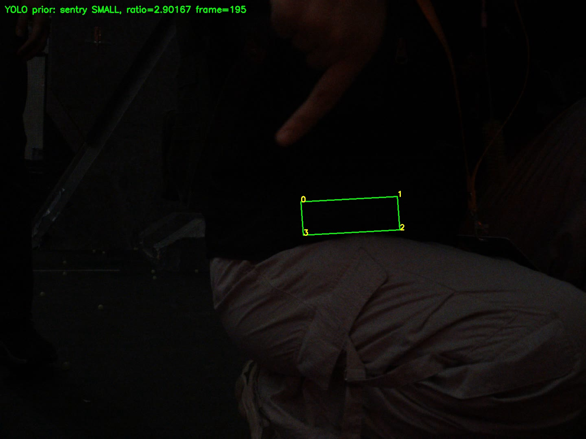

# 重新融合实际测试报告

结果：**普通离线构建成功，14/14 测试通过；ASan/UBSan 13/14，通过模型加载前的算法与 Mock，模型测试失败/阻塞。整车构建未完成，未实车验证，未提交/推送。**

来源完整 SHA 和重建基线见 source_version_comparison.md；代码和参数映射见 algorithm_migration.md。候选工作树现已检出本地 `sentry毅同融合`，HEAD仍为3a52df8；改动未提交，不存在新的融合提交 SHA。本轮没有更改算法代码，已有构建/测试结论保持原来的执行范围。

## 实际构建

| 项目 | 执行结果 |
|---|---|
| A405b408 独立 CMake 配置 | 失败：找不到 rclcpp；已尝试，未进入整车编译 |
| 历史 B3a52df8 离线构建/回归 | 构建成功，18/18；仅证明旧版本原测试仍可运行，不代表新工程通过了这些旧测试 |
| 新候选 FUSION_OFFLINE_ONLY | 完整构建成功：tongji_core、原车算法/Planner、fusion_regression、fusion_offline、fusion_serial_mock |
| 新候选软件编译检查 | 原车 review、大符6个编译单元及 SerialPort.cpp 通过对象编译；未伪装成整车链接 |
| 新候选 FUSION_SANITIZE | 构建成功；13项通过，fusion_model 失败：TBB RTLD_DEEPBIND 与 ASan 冲突 |
| 新候选整车默认 CMake | 失败：rclcpp 缺失；/opt/MVS 也缺失，不宣称 SDK/设备运行成功 |

管理员安装受限：sudo 需要密码；未修改系统软件源、未索要密码、未假造 ROS2/MVS stub。

## 14项当前测试

| 测试 | 普通构建 | ASan/UBSan | 实际覆盖范围 |
|---|---|---|---|
| serial_mock | 通过 | 通过 | 原车真实 SerialPort 类只打开 openpty 创建的 /dev/pts/；验证完整21字节正值 RX 字段/单位、TX原包，fire=0 |
| calibration | 通过 | 通过 | 原车姿态公式多角度等价、RGB→BGR、原点参数 |
| type | 通过 | 通过 | SMALL/BIG双假设、俯视合成、英雄类型与PnP一致、原车过滤 |
| pose | 通过 | 通过 | 真实A标定、两种尺寸/多yaw合成PnP；位置门限3mm、yaw0.03rad |
| tracker | 通过 | 通过 | 合成静止目标、丢失/重识别、四甲和两甲关联边界 |
| outpost | 通过 | 通过 | A的0.225m初值、三甲、静止禁用输出及2.51rad/s旋转恢复输出 |
| planner | 通过 | 通过 | 同济模型快照接入原车Planner，验证弧度及22m/s弹道输出范围 |
| ekf | 通过 | 通过 | 合成匀速观测、有限性、协方差对称；修复诊断日志低维越界 |
| protocol | 通过 | 通过 | 从原驱动逐字提取的方法，AA BB 21字节黄金包，导航字段保留 |
| time | 通过 | 通过 | 倒退、长时间间隔、非有限姿态 |
| empty | 通过 | 通过 | 空帧、缺角点、NaN角点、非法颜色 |
| player | 通过 | 通过 | 小录像+元数据fixture；1小时无溢出、坏行、前后跳转、RGB存储恢复 |
| hold | 通过 | 通过 | 保持期fire清零、当前导航保留、复位清除旧状态 |
| model | 通过 | **失败/阻塞** | YOLO11与分类模型实际加载、黑帧推理；ASan下第三方库dlopen冲突 |

独立额外执行：YOLOv5、YOLOv8 加载/黑帧推理通过；不存在的模型路径被拒绝（预期退出1）。这不表示这两个可选后端已做真实录像分类精度验证。
没有关闭 sanitizer 检查或将该失败改为 skip/pass；不宣称模型/录像内存检查通过。

## 真实录像

资源：C独立仓库 main@bd9f5e7 中本地已有的 `assets/demo/demo.avi`，前200帧，未改源录像。录像不在b2c7dc5树内，仅作为已有测试数据；算法和模型仍严格来自b2c7dc5，未切换算法来源。录像哈希见video_resource.json。
使用CPU、inference_threads=1、OpenCV单线程，RelWithDebInfo；模型初始化和视频解码不计入逐帧处理耗时。

| 指标 | 观察值 |
|---|---|
| 完成帧数 | 200 |
| 原始候选总数 | 147 |
| 类别/类型先验 | sentry SMALL，147项 |
| 平均处理时间 | 33.7414 ms |
| P95处理时间 | 35.166 ms |
| 换算处理速率 | 29.64 帧/s，仅检测阶段等效值 |
| 进程峰值RSS | 196836 KiB（约192.2 MiB） |
| 进程退出码 | 0（普通构建） |

147是候选数量，不是正确检测数或准确率。录像缺少原车姿态和逐帧大小真值，**未运行该片段的世界位姿/Tracker**，CSV明确写 `not_run_without_attitude`。
缺少真实BIG与原车低机位标注录像，不能给出不同角度分类准确率或实车稳定性结论。



## 安全边界和未验证项目

离线可执行文件不含工业相机/真实串口/ROS2对象。单独 serial_mock 仅使用它自己创建的 PTY，未打开真实 /dev/ttyACM0；本次未运行 action/review/aim_preview、未SSH、未发真实运动或发射命令。
`nm`检查 fusion_offline 没有 io::SerialPort/HikRobot/ROS2 符号；`ldd` 无 not found，存在系统TBB2和OpenVINO TBB12，两者运行时兼容/内存检查尚需处理。

仍需：安装ROS2/MVS后完成整车链接；实际SDK相机型号/分辨率/颜色核验；串口分包/粘包和跨π平均；导航ROS2运行；原车录像准确率及实际姿态同步；真实BIG、小甲俯视、快速运动/遮挡/重识别；云台方向/角限/急停/断流。
原车 action 目前不具备已验证的只读输出开关，不能用它冒充整机只读测试。

## 实际修改函数与文件

主要新增：TongjiAdapter构造/process/update/reset/resolve_type/accept_type/original_rotation/to_bgr/detect_only；TongjiModel构造/GetArmors；离线与回归测试入口。
主要适配：AutoArmor构造/AutoAim/Reset；Planner构造的路径注入；AimStateMachine::Step/Reset；main的复位与访问检查；Player构造/read/seek；review入口。
C副本构造改为YAML::Node，Solver::solve、Tracker::track/set_target、Target::update、EKF::update、各YOLO后处理及调试路径按迁移说明修复。原车Transmit和SerialPort.cpp函数未改。
全部新增、修改及移除项在 rebuild_changed_files.txt；移除的前两次算法/测试/旧报告仍可从3a52df8及bundle访问，没有重写历史。

## 复现命令

```bash
cmake -S . -B build-offline -DFUSION_OFFLINE_ONLY=ON -DOpenVINO_DIR=/opt/intel/openvino_2024.6.0/runtime/cmake -DCMAKE_BUILD_TYPE=RelWithDebInfo
cmake --build build-offline -j2
ctest --test-dir build-offline --output-on-failure
cmake -S . -B build-asan -DFUSION_OFFLINE_ONLY=ON -DFUSION_SANITIZE=ON -DOpenVINO_DIR=/opt/intel/openvino_2024.6.0/runtime/cmake -DCMAKE_BUILD_TYPE=Debug -DCMAKE_CXX_FLAGS_DEBUG='-O0 -g1'
cmake --build build-asan -j2
ctest --test-dir build-asan --output-on-failure
```

ASan最后一项预期仍暴露上述环境冲突，命令不承诺全部通过。实际原始输出均保存在 rebuild_validation/。
启动、停止、模型路径、相机/串口/ROS2检查、人工分阶段验收及回滚见 real_robot_deployment.md。

## Git交付状态

按用户最新指令「只修改指定本地分支，不提交、不推送」，本轮将候选工作树接到现有本地 `sentry毅同融合`，未创建提交、未推进任何分支的提交 SHA、未推送，也未尝试 SSH。
工作目录是 `/home/yuningli/RM-auto-aim/sentry-rebuild-uas0ydrd/worktree`；在 VS Code 中打开此目录可查看目标分支的全部未提交改动。

用户终端反馈 HTTPS 查询成功；当前工具环境同 URL 查询仍认证失败。此差异不阻塞本地处理，但不能据此宣称远端分支已核实或已同步。
本轮没有运行 fetch/pull/merge，也没有覆盖源 A/C 或原 IDE 工作树。仅更新本地工作树归属和文档，算法内容与此前通过测试的候选快照一致。
详情见 `rebuild_validation/local_branch_status.json`。在用户明确改变「不提交、不推送」要求前，不会自动执行提交或推送。
